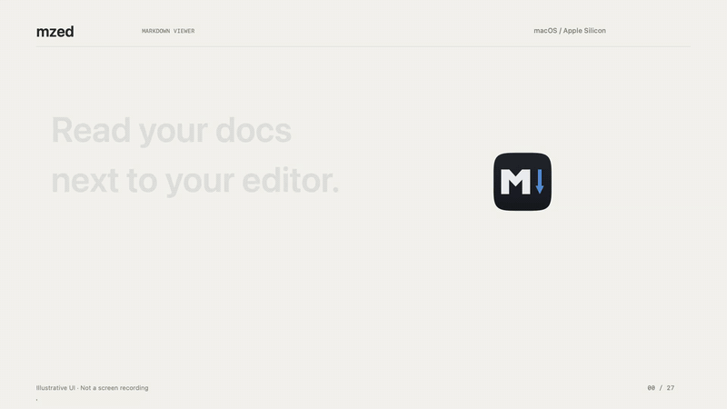
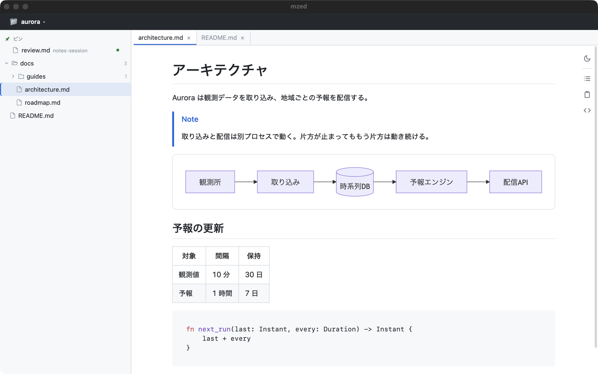

<p align="center">
  
</p>

# mzed

[](https://github.com/MizuRyu/mzed/releases)
[](LICENSE)

mzed is a Markdown viewer for the Mac.

It detects the project open in Zed (the editor) or Orca (a worktree manager) and shows its docs alongside. It is for reading the Markdown your AI agents write without opening it in the editor.

日本語版: [README.md](README.md)

[](images/mzed-demo-en.mp4)

*A 27-second feature tour. Click to play it with music. The UI is illustrative, not a screen recording.*

## What it does

- **Follows your editor.** Switch projects in Zed or Orca and the docs on screen switch too. Opening a git worktree shows its parent repository, with each worktree's Markdown merged into that tree.
- **Renders like GitHub.** Mermaid, KaTeX, syntax highlighting, GitHub Alerts, and frontmatter. Saving a file re-renders it at once.
- **Passes Markdown to and from agents.** An agent in another session hands you a file with `mzed --pin`, and it appears at the top of the sidebar with a green dot. Notes you leave on selected text while reading are picked up and applied by an agent through the `mzed` skill.



*A fictional project, "aurora", open in mzed.*

There are also tabs and a split pane, a table of contents, a command palette, fuzzy file search, full-text search, Task View, HTML / PDF export, and a browser view (`mzed serve`).

## Installation

Runs on Apple Silicon Macs.

This command fetches the latest release into `/Applications`, removes the quarantine attribute, and creates the CLI symlink. Run it again to update.

```sh
curl -fsSL https://raw.githubusercontent.com/MizuRyu/mzed/main/scripts/install.sh | bash
```

To install by hand, download the `.dmg` from [Releases](https://github.com/MizuRyu/mzed/releases) and move `mzed.app` to `/Applications`. The app is unsigned, so remove the quarantine attribute once.

```sh
xattr -dr com.apple.quarantine /Applications/mzed.app
ln -sf /Applications/mzed.app/Contents/MacOS/mzed ~/.local/bin/mzed  # for CLI use
```

To build from source, see [docs/development.md](docs/development.md).

### Agent skill

`agents/skills/mzed` teaches an AI agent (Claude Code, or any agent that reads `SKILL.md`) to hand you its Markdown with `mzed --pin`, and to apply the notes you leave in mzed. Install it into your global skills:

```sh
mkdir -p ~/.claude/skills && curl -fsSL https://github.com/MizuRyu/mzed/archive/refs/heads/main.tar.gz | tar -xz -C ~/.claude/skills --strip-components=3 mzed-main/agents/skills/mzed
```

From a clone, `ln -s "$PWD/agents/skills/mzed" ~/.claude/skills/mzed` keeps it current with `git pull`.

## Usage

```sh
mzed               # start following Zed / Orca
mzed file.md       # open a file in a tab
mzed --pin a.md    # pin a file in the sidebar without opening it
mzed ./docs        # open a directory as the root
mzed serve ./docs  # serve a folder in the browser (127.0.0.1 only, for screen sharing)
```

When mzed is already running, later commands go to its window.

| Key | Action |
| --- | --- |
| `Cmd+Shift+P` | Command palette |
| `Cmd+P` | Fuzzy file search |
| `Cmd+F` | Find in document |
| `Cmd+O` | Switch project |
| `Cmd+Shift+L` | Hold / resume following |
| `Cmd+Shift+M` | Add a note on the selected text |
| `Cmd+Shift+D` | Show / hide Task View |
| `Cmd+\` | Split pane |
| `Cmd+W` | Close tab (closes the window on the last tab) |
| `Cmd+,` | Settings |

Key bindings can be changed in settings.

## Settings

`Cmd+,` opens settings. They are saved to `~/.config/mzed/config.json`.

| Setting | What it controls |
| --- | --- |
| Sync (`sync_mode`) | `auto` switches the project and its docs (default), `self` the project only, `off` nothing |
| Source (`sync_source`) | `zed`, `orca`, or both (`auto`, default) |
| Worktrees (`worktree_switch`) | On opening a worktree: show the parent repository (default), ignore it, or open it as is |
| Line breaks (`line_breaks`) | Whether a single newline in a paragraph renders as a line break (default: yes) |
| Pin expiry (`pin_expiry`) | On open, 1 hour, 24 hours (default), 1 week, or never |
| Never unread (`unread_exclude`) | File names, folder names, or paths that never get the green dot |

Every setting is in the [settings spec](docs/specs/10-settings-and-context-menu.md) (Japanese).

## Development

```sh
nix develop
just run
just verify
just bundle
```

See [docs/development.md](docs/development.md) for build, test, and release, and [docs/README.md](docs/README.md) for specs and design (Japanese).

## Acknowledgements

The design and UX draw on these projects.

- [Zed](https://github.com/zed-industries/zed) — the editor mzed follows; also the reference for its key bindings and command palette
- [mo](https://github.com/k1LoW/mo) — a browser-based Markdown viewer; `mzed serve` brings that use case into mzed
- [Arto](https://github.com/arto-app/Arto) — the drop-a-file-and-see-it-immediately experience

## License

[MIT](LICENSE)

Full license texts for the redistributed third-party assets (github-markdown-css, highlight.js, Mermaid, KaTeX) are in [THIRD-PARTY-LICENSES.md](THIRD-PARTY-LICENSES.md).
