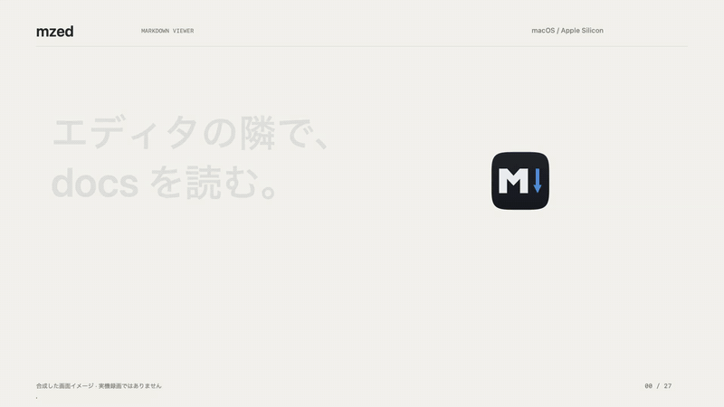
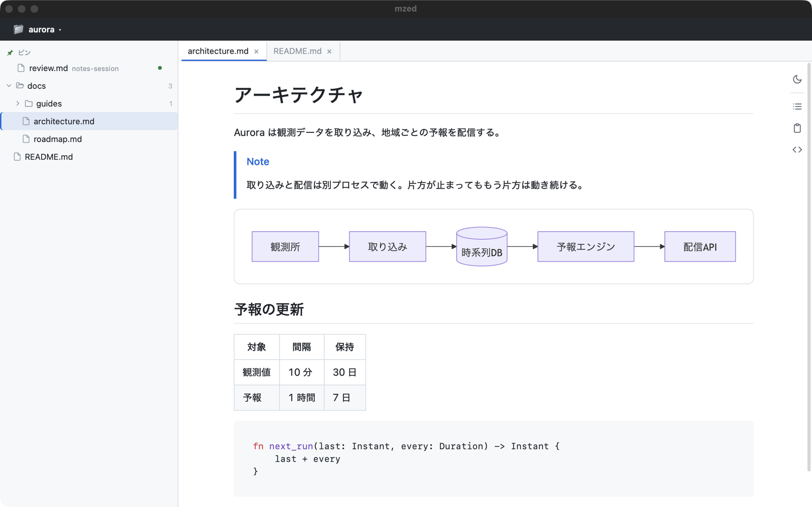

<p align="center">
  
</p>

# mzed

[](https://github.com/MizuRyu/mzed/releases)
[](LICENSE)

mzed は、Mac 用の Markdown ビューアです。

Zed（エディタ）や Orca（worktree 管理ツール）で開いているプロジェクトを検知し、その docs を隣に表示します。AI エージェントが書いた md を、エディタを開かずに読むための道具です。

English version: [README.en.md](README.en.md)

[](images/mzed-demo-ja.mp4)

*機能を紹介する20秒の動画です。クリックすると音楽付きで再生します。画面は架空のプロジェクトを開いて撮ったものです。*

## できること

- **エディタに追従して docs を表示する。** Zed や Orca でプロジェクトを切り替えると、表示中の docs も切り替わります。git worktree を開いたときは親のリポジトリを表示し、各 worktree の md をそのツリーに重ねて見せます。
- **GitHub と同じ見た目で読む。** Mermaid、KaTeX、シンタックスハイライト、GitHub Alerts、frontmatter を描画します。保存すると即座に再描画します。
- **エージェントと md をやりとりする。** 別のセッションのエージェントが `mzed --pin` で md を渡すと、サイドバーの上に緑の丸付きで並びます。読みながら本文を選んで残したメモは、エージェントがスキル `mzed` で読んで反映します。



*架空のプロジェクト「aurora」を開いた画面です。*

ほかに、タブと左右分割、目次、コマンドパレット、ファジー検索、全文検索、Task View、HTML / PDF へのエクスポート、ブラウザでの表示（`mzed serve`）があります。

## インストール

Apple Silicon の Mac で使えます。

次のコマンドで最新版を取得して `/Applications` に配置し、quarantine 属性の解除と CLI の symlink 作成まで行います。更新にも同じコマンドを使います。

```sh
curl -fsSL https://raw.githubusercontent.com/MizuRyu/mzed/main/scripts/install.sh | bash
```

手動で入れる場合は、[Releases](https://github.com/MizuRyu/mzed/releases) から `.dmg` をダウンロードし、`mzed.app` を `/Applications` に置きます。署名していないため、初回は quarantine 属性を解除してください。

```sh
xattr -dr com.apple.quarantine /Applications/mzed.app
ln -sf /Applications/mzed.app/Contents/MacOS/mzed ~/.local/bin/mzed  # CLI を使う場合
```

ソースからビルドする場合は [開発手順](docs/development.md) を参照してください。

### エージェント用スキル

`agents/skills/mzed` は、AI エージェント（Claude Code など `SKILL.md` を読むもの）に、書いた md を `mzed --pin` で渡す手順と、mzed に残したメモを反映する手順を教えます。グローバルの skills に入れてください。

```sh
mkdir -p ~/.claude/skills && curl -fsSL https://github.com/MizuRyu/mzed/archive/refs/heads/main.tar.gz | tar -xz -C ~/.claude/skills --strip-components=3 mzed-main/agents/skills/mzed
```

clone して使う場合は、`ln -s "$PWD/agents/skills/mzed" ~/.claude/skills/mzed` にすると `git pull` で更新が届きます。

## 使い方

```sh
mzed               # Zed / Orca に連動して起動
mzed file.md       # ファイルをタブで開く
mzed --pin a.md    # 開かずにサイドバーへピン留め
mzed ./docs        # ディレクトリをルートにして開く
mzed serve ./docs  # フォルダをブラウザで表示（127.0.0.1 のみ。画面共有向け）
```

起動中の mzed があれば、2 回目以降のコマンドはそのウィンドウに渡します。

| キー | 操作 |
| --- | --- |
| `Cmd+Shift+P` | コマンドパレット |
| `Cmd+P` | ファイルのファジー検索 |
| `Cmd+F` | ドキュメント内検索 |
| `Cmd+O` | プロジェクト切り替え |
| `Cmd+Shift+L` | 追従の固定／解除 |
| `Cmd+Shift+M` | 選択した本文にメモを追加 |
| `Cmd+Shift+D` | Task View の表示／非表示 |
| `Cmd+\` | 左右分割 |
| `Cmd+W` | タブを閉じる（最後のタブならウィンドウも閉じる） |
| `Cmd+,` | 設定 |

キーバインドは設定画面で変更できます。

## 設定

`Cmd+,` で設定画面を開きます。内容は `~/.config/mzed/config.json` に保存されます。

| 設定 | 内容 |
| --- | --- |
| 連動（`sync_mode`） | `auto` はプロジェクトと docs を切り替える（既定）、`self` はプロジェクトだけ、`off` は連動しない |
| 追従元（`sync_source`） | `zed`、`orca`、両方（`auto`、既定） |
| worktree（`worktree_switch`） | worktree を開いたとき、親リポジトリを表示する（既定）、無視する、そのまま開く |
| 改行（`line_breaks`） | 段落内の 1 回の改行を改行として表示するか（既定は表示する） |
| ピンの自動削除（`pin_expiry`） | 開いたとき、1 時間、24 時間（既定）、1 週間、削除しない |
| 未読にしないファイル・フォルダ（`unread_exclude`） | 緑の丸を付けないファイル名・フォルダ名・パス |

すべての項目は [設定の仕様](docs/specs/10-settings-and-context-menu.md) にあります。

## 開発

```sh
nix develop
just run
just verify
just bundle
```

ビルド・テスト・配布は [開発手順](docs/development.md)、仕様と設計は [ドキュメント一覧](docs/README.md) を参照してください。

## 謝辞

設計と UX は次のプロジェクトから影響を受けています。

- [Zed](https://github.com/zed-industries/zed) — 連動先のエディタ。キーバインドとコマンドパレットの操作感も参考にしました
- [mo](https://github.com/k1LoW/mo) — Markdown をブラウザで見せるビューア。`mzed serve` はこの用途を mzed に取り込んだものです
- [Arto](https://github.com/arto-app/Arto) — ファイルをドロップしてすぐ表示する体験

## License

[MIT](LICENSE)

再配布しているサードパーティのアセット（github-markdown-css、highlight.js、Mermaid、KaTeX）のライセンス原文は [THIRD-PARTY-LICENSES.md](THIRD-PARTY-LICENSES.md) に収録しています。
